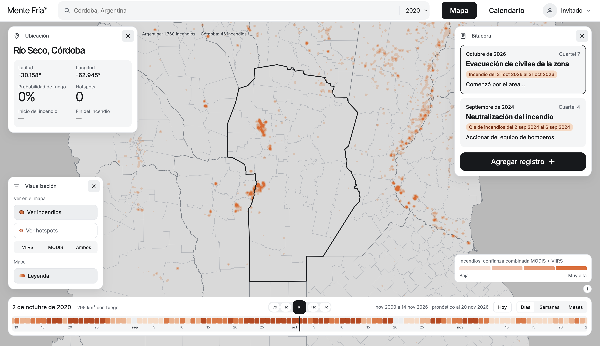
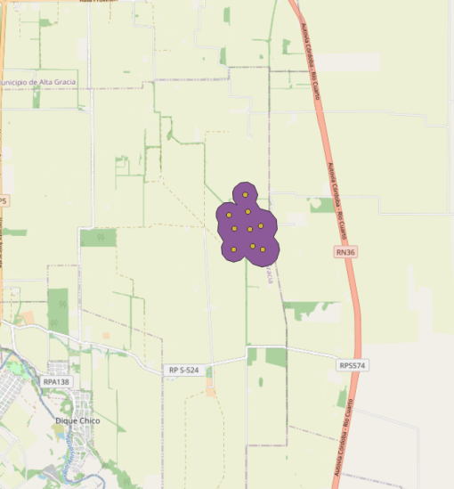
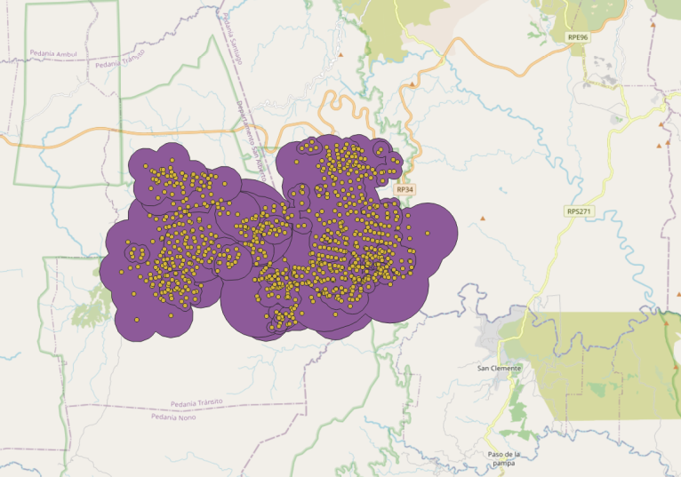
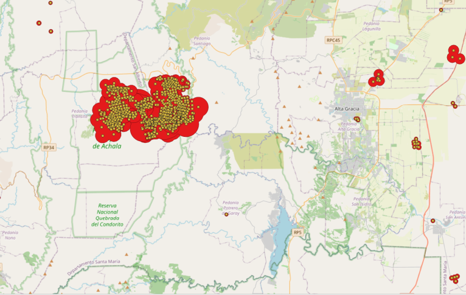
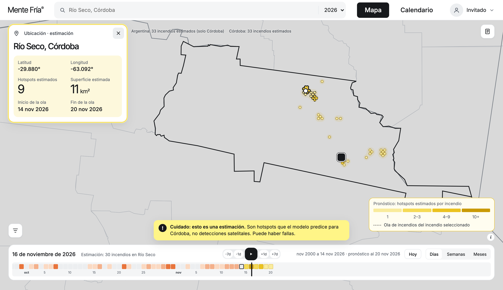

# nasa-space-app-modis

*[Leer en español](README.md)*

> "mente fría" web tool: a harmonized fire activity calendar built from the MODIS and VIIRS hotspots of NASA FIRMS, together with a pilot hotspot prediction for Córdoba.



**NASA Space Apps Challenge** · Challenge: *Harmonization of MODIS and VIIRS Hot Spots*

**Team:** Firewall

| Member | Background |
|---|---|
| Ana Carolina Olivera | PhD in Computer Science\* |
| Francisco Devaux | Computer Science student\* |
| Aída Laricchia | Computer Science student\* |
| Ignacio Coppede Santos | Computer Science student\* |
| Franco Elian Gimenez | Graphic Design student\*\* |
| Martina Nahman | Computer Science student\* |

\* Universidad Nacional de Cuyo  
\*\* Instituto Manuel Belgrano

---

## Summary

We developed a method to harmonize the MODIS and VIIRS hotspots of NASA FIRMS, applied to all of Argentina between 2000 and 2026. Instead of comparing isolated points, we group hotspots into physically meaningful units: fires, which gather the pixels that touch within a 12-hour window, and firewaves, which chain fires over the days. Each unit has its own polygon and a confidence that combines both sensors. This way the sensor of origin no longer matters, as the challenge asks. Because the method uses the real size of each pixel, it adapts to new satellites once MODIS stops operating. We added a pilot in Córdoba, the province from which CONAE presented the challenge: a CNN + LSTM model that anticipates new hotspots seven days ahead. In addition, the web tool offers a space where firefighters record reports in the log of each firewave, which could guide future action plans. This work matters because fires are becoming more frequent and intense, so emergency managers need a reliable historical reference.

## Problem

**Fire regimes are changing.** Some ecosystems need periodic fires to keep their structure and function. However, changes in the intensity, extent or frequency of fires affect climate, society, biodiversity and even ecosystem services. Fires also cause human and material losses. They harm public health and put those who fight them at risk [2].

**Satellites make it possible to track them.** Climate models project increasingly frequent and intense fire conditions. Earth observation satellites measure thermal radiation and smoke from regional to global scale. They support early detection, rapid response and post-fire assessment. In particular, sensors operating in the mid and thermal infrared detect **hotspots** generated by fires, volcanoes or industrial processes. Two of those sensors are MODIS and VIIRS [2].

**Fire activity calendars** combine historical information with recent data. They make it possible to quickly identify the seasonal patterns, anomalies or trends of each region [2].

The MODIS sensors on board Terra and Aqua hold more than two decades of observations. However, they are reaching the end of their lifetime and are being replaced by VIIRS [7][8]. The problem is that the records of both sensors **cannot be compared directly without harmonization**, since they differ in spatial resolution, sensitivity and observation times [2].

Therefore, as fires become more frequent and intense, emergency managers need an up-to-date and consistent hotspot calendar. With it they could identify the months or years of highest fire activity [2].

## Objectives

### General objective

Develop a web application with a harmonized fire activity calendar based on satellite hotspots that combines the long MODIS record with the continuity and finer detail of VIIRS, in order to obtain a consistent time series [2].

### Specific objectives

1. Harmonize the MODIS and VIIRS hotspots of NASA FIRMS so that the sensor of origin no longer influences the analysis.
2. Build, from the harmonized data, a consistent time series that makes it possible to identify patterns, trends or anomalies in fire activity.
3. Develop a web application that, from the harmonized data, allows selecting a region together with a date range.

## Our solution

Our proposal harmonizes the MODIS and VIIRS hotspots with a focus on Argentina. We worked with every NASA FIRMS record available for the country: MODIS from November 2000 to November 2026 and VIIRS from January 2012 to the same date [3].

We also added a hotspot prediction stage with a pilot in **Córdoba**. We chose this province because the *Harmonization of MODIS and VIIRS Hot Spots* challenge came from CONAE, the Argentine space agency and NASA Space Apps partner [12]. The official challenge video presents it from the Teófilo Tabanera Space Center, in Córdoba [13]. Details are in [Hotspot prediction in Córdoba](#hotspot-prediction-in-córdoba).

Instead of comparing isolated hotspots, we group them into units that represent the same thing regardless of the satellite that detected them. This way the sensor of origin is no longer relevant. The grouping has three levels:

- **Hotspot:** each original FIRMS detection. It keeps its format unchanged.
- **Fire:** a cluster of hotspots whose pixels touch within the same 12-hour window. A fire can combine MODIS and VIIRS detections.
- **Firewave:** a set of nearby fires that follow one another in time. For example, a fire front that advances for several days forms a single firewave.

Each fire has a polygon that outlines its extent, and so does each firewave. Both also have their own confidence metric that combines the information of both sensors.

This approach is independent of the satellite that acquires each hotspot. Therefore, the harmonization can incorporate new satellites without redesigning the method (see section 7).

Processing is split into chained stages. All thresholds, weights and periods are defined in a configuration file, so no value is hard-coded.

### 1. Ingestion and cleaning

We read the raw FIRMS CSV files: the archive, the standard product (SP) and the near real-time data (NRT). Then duplicate detections are removed. When the same hotspot appears in more than one product, the standard product takes priority over NRT.

To keep only vegetation fires, we keep hotspots with `type = 0`. This discards volcanoes, static sources (for example, factories) and offshore detections [4][5].

However, NRT data has no `type` field [3]. We therefore infer it from the archive: an NRT hotspot is discarded if its pixel touches that of a hotspot with `type ≠ 0` detected during the previous 365 days. The criterion follows NASA's definition, which considers a static source to be a point detected on 16 or more days in the same year [5]. When NASA publishes the standard product for those dates, the inferred value could be replaced by the official one, since the standard product does include `type` [4].

Finally, we do not clip the data to Argentina before grouping. Fires are formed first with all points, then those with at least one hotspot inside the country are kept. This way, border fires are not split.

### 2. Common confidence class

Each sensor reports confidence differently: MODIS uses a number from 0 to 100, while VIIRS uses the classes `l` (low), `n` (nominal) or `h` (high) [4]. Since VIIRS is the reference for the future, we map MODIS to the VIIRS classes with NASA's official thresholds (Table 11 of [5]):

| MODIS confidence | Class |
|---|---|
| 0 ≤ C < 30 | `l` |
| 30 ≤ C < 80 | `n` |
| 80 ≤ C ≤ 100 | `h` |

This common class is used only to compute fire confidence. The original confidence of each hotspot is not modified.

### 3. From hotspots to fires: spatial clustering

**12-hour window.** First, detections are split into 12-hour day or night windows, with cuts at 07:00 and 19:00 (Argentina time). No satellite passes at those times, so no overpass is split.

**Pixel contact.** A hotspot's coordinate is the center of the pixel, but the fire can be anywhere inside it [3]. Pixel size also varies: in MODIS it goes from 1 km at nadir to almost 5 km at the edge of the swath, while in VIIRS it is 375 m [3][4]. A fixed distance would split fires or merge different fires.

Therefore, two hotspots belong to the same fire if their pixels touch, even at a corner. This is the same contact criterion used by other fire products listed in Table 1 of [15]. Each pixel is approximated by the circle that contains it, whose radius is half the pixel diagonal:

```
r_i = ½ · √(scan_i² + track_i²)
i ~ j  ⇔  d_ij ≤ r_i + r_j
```

Here `scan` × `track` is the real pixel size reported by FIRMS [4] and `d_ij` is the distance between centers. Because each hotspot brings its own radius, the same criterion works for MODIS–MODIS, VIIRS–VIIRS or mixed pairs:

| Pixel pair | Maximum distance |
|---|---|
| MODIS + MODIS (nadir) | 1.41 km |
| VIIRS + VIIRS (nadir) | 0.53 km |
| MODIS + VIIRS (nadir) | 0.97 km |
| MODIS + MODIS (swath edge) | 5.2 km |

Distances are computed in meters on a single Transverse Mercator projection centered on the −63° meridian, the same as zone 4 of POSGAR 2007 [16]. This way a fire is never split across two coordinate systems.

Finally, fires are obtained through **spatial clustering** of the hotspots: a k-d tree finds the nearby pairs and a connected-components algorithm groups them. The result is equivalent to a DBSCAN with `min_samples = 1` where the distance between two hotspots is divided by the sum of their radii (`d_ij / (r_i + r_j)`, with `eps = 1`) [19]. We verified it on the 2025 hotspots: both methods give the same partition in all 729 windows. Isolated hotspots form single-point fires, which are also kept.



*Figure 1. Fire produced by the clustering near Dique Chico and Alta Gracia (Córdoba, 2025), seen in QGIS. Yellow points are hotspots, while the purple area is the fire formed by their touching pixels.*

### 4. From fires to firewaves

A fire that continues the next day appears as a new fire in another 12-hour window. To rebuild the whole fire, we go through the windows in time order following NASA's FEDS algorithm [6][15]:

- A fire joins an active firewave if any of its hotspots is within `r_i + r_j + buffer` of a firewave hotspot detected in the last 5 days.
- The buffer is **5 km** when the firewave is in a forested protected area. Otherwise it is **1 km**.
- If a fire touches two or more firewaves, they are merged into one.
- A firewave closes after 5 days without new fires.

The buffer prevents a fire front from splitting into several firewaves when it advances between overpasses [18] or when it is hidden by clouds or smoke [3]. The 1 and 5 km values and the 5 days come from FEDS, which works with the same type of data (375 m VIIRS) [15]. In our case, the 5 km buffer applies only to forests inside protected areas.

### 5. Confidence metric

We add a new metric, `confidence` (0 to 100 %), for each fire and each firewave. Its components, in order of importance, are:

1. **Independent corroboration.** Confidence increases when another sensor or another overpass detects the same fire. Some false detections depend on the conditions of each overpass, such as sun glint [5], so hotspots from the same overpass are not independent evidence. Therefore, overpasses are counted instead of points.
2. **NASA class of the hotspots.** Each class contributes a score (`h` = 0.90, `n` = 0.55, `l` = 0.15), the midpoint of the ranges in Table 11 of [5]. MODIS hotspots are multiplied by 0.80 because of their lower precision.
3. **Absence of VIIRS.** VIIRS detects small fires better [3]. Therefore, if MODIS detected a fire that VIIRS did not see while operational, confidence decreases. The operational periods of each satellite come from [7][8][9]. Before 2012 this penalty does not apply, since VIIRS did not exist yet.
4. **Size.** The total pixel area adds a slight contribution. Area is used instead of the number of hotspots, since one MODIS pixel (1 km) covers the area of about 7 VIIRS pixels (375 m) [3].

```
p_i  = p(class_i) · w_sensor_i
P    = 1 − (1 − p_MODIS) · (1 − p_VIIRS)          ← combines both sensors (noisy-OR)
P    ← 1 − (1 − P) · (1 − 0.20)^(k − 1)           ← k = number of distinct overpasses
confidence = 100 · P · f_size · f_VIIRS_absence
```

For example, a fire with one MODIS hotspot of class `n` and one VIIRS hotspot of the same class gets 75 %.

To keep the metric **comparable across eras**, corroboration is limited to one observation per sensor family. Otherwise, recent years with five satellites would always have more confidence than the early ones with a single satellite. The firewave takes the area-weighted average confidence of its fires.

### 6. Polygons and context

- **Fire polygon:** union of the circles of its hotspots. Since the circles of a fire touch, the result is always a single polygon.
- **Firewave polygon:** union of the polygons of its fires. It can have several parts, since fires are linked with a buffer.
- **Protected area:** a fire is in a protected area if at least one of its hotspots falls inside one of the 506 areas of the IGN layer [17].
- **Forest:** a fire is a forest fire if the majority land cover under its polygon is forest, according to the NASA MCD12Q1 product of that year [10]. The majority criterion is the same used by FEDS [15].



*Figure 2. Fire polygons in the Sierras Grandes of Córdoba (2025), seen in QGIS. Each purple polygon is the union of the circles of its hotspots (yellow points). Larger circles are MODIS pixels, which can contain smaller VIIRS circles, since one fire can combine detections from both sensors. Overlapping polygons are fires from different 12-hour windows, since within one window two touching circles always belong to the same fire.*

### 7. Continuity without MODIS and adaptability to new satellites

Each fire has an `era` column (MODIS only, MODIS + VIIRS or VIIRS only). The metric works without MODIS: a fire detected only by VIIRS with class `h` gets 90 %, while one detected only by MODIS before 2012 has a ceiling of 72 %. Thanks to this, the pipeline will remain useful when Terra and Aqua stop operating [7].

The method does not depend on a particular sensor. The contact criterion uses the real size of each pixel, and the common confidence class can translate any scale to `l`/`n`/`h`. Also, confidence counts one observation per sensor family, so adding satellites does not change the comparability of the series.

Data sources, satellites and their operational periods are defined in the configuration file. Adding or removing a satellite therefore requires no code changes. This mechanism was already used to add NOAA-21 [9] and to record the Terra standby [8] and the end of S-NPP [9]. A future VIIRS satellite, such as JPSS-3 or JPSS-4 [14], would be added the same way. A new sensor family, on the other hand, also requires defining its weight and extending the confidence computation.

### Outputs

| File | Content |
|---|---|
| `hotspots.parquet` | hotspots in the original FIRMS format, with the id of their fire and firewave |
| `incendios.parquet` | attributes of each fire, including its polygon |
| `eventos.parquet` | attributes of each firewave, including its polygon |
| `fuego.gpkg` | GeoPackage with hotspot, fire, firewave, protected area and province layers, ready to open in QGIS |

All project data, including these outputs, is available in [1]. Coordinates are exported in WGS84 (longitude/latitude), the same system used by FIRMS [3]. Every design decision is detailed in [PLAN.md](PLAN.md).

To check the clustering, we loaded the outputs in QGIS over a reference map:



*Figure 3. Regional view of Córdoba (2025) in QGIS. Yellow points are hotspots and red areas are fires. A large fire is visible in the Sierras Grandes, next to the Quebrada del Condorito National Reserve, along with small fires around Alta Gracia.*

## Hotspot prediction in Córdoba

**Why Córdoba.** The *Harmonization of MODIS and VIIRS Hot Spots* challenge came from CONAE. In the official presentation video, Marina Compagnucci, from CONAE, introduces the problem from the Teófilo Tabanera Space Center, in Córdoba [13]. That is why the prediction pilot covers this province, while the harmonization covers the whole country.

**Goal.** The harmonized calendar describes fire activity that already happened. The prediction stage, in contrast, aims to anticipate where new hotspots may appear in the seven days after a detection. The model does not predict fires or firewaves directly: it predicts hotspots that are then grouped with the same logic of sections 3 and 4. This keeps the same fire and firewave definitions throughout the project, without creating a new entity.

### Scope and data

The pilot uses a grid of 1 km cells in an equal-area projection (EPSG:6933). Each sample is anchored on an observed hotspot [3][4], from which a 32 × 32 cell patch (32 × 32 km) is built with 14 days of history and a 7-day horizon. To avoid nearly identical patches, one sample is used per cell-day with at least one hotspot. The cell-day is only the reading point, not a new entity: the model still works with hotspots.

Periods were split in time so that neither validation nor test share information with training:

| Period | Dates | Hotspots | Samples (cell-day) |
|---|---|---:|---:|
| Training | 2019-01-01 → 2025-07-24 | 91,074 | 32,661 |
| Validation | 2025-08-01 → 2026-07-24 | 6,133 | 2,913 |
| Test | 2026-08-01 → 2026-11-07 | 2,223 | 1,145 |

We chose 2019–2025 because it captures the recent regime of sensors and fuel. In the resulting set, 0.45 % of the cell-days are positive, while 72.3 % of the anchors have at least one future hotspot inside the patch. A seven-day purge was also applied at the boundaries between periods so that no label crosses the limit.

### Representation

Each sample combines 20 dynamic history channels, 7 future weather channels, 12 static channels and a vector of 17 attributes of the anchor hotspot:

- **History:** summarizes the hotspot field (count, presence, Gaussian density, FRP, confidence, sensor, day/night) and the observed weather. Weather comes from NASA POWER [11][20], plus derived variables such as VPD, days without rain or accumulated precipitation over 7 and 30 days.
- **Future weather:** seven days of weather. During training, validation and test, observed NASA POWER values replaced the forecast [11][20], since there is no historical archive of forecasts. The operational prediction uses the 7-day extended forecast from Open-Meteo [21], because NASA POWER does not provide forecasts.
- **Static:** the Córdoba mask, the department, the previous year's land cover, protected areas [17], fire climatology, distance to the patch center, distance to the nearest known hotspot and days since the last hotspot. Land cover is taken from the previous year so as not to include scars from the same fire year [22].
- **Anchor:** FRP, confidence, sensor, satellite, pixel size, day/night, time, season and the ONI of the previous quarter [28].

### Model and training

The network has three parts [23][24]:

1. A shared CNN encodes each day of history.
2. An LSTM summarizes the 14-day sequence.
3. A convolutional decoder, conditioned on the anchor vector and the future weather of each day, produces seven 32 × 32 maps with the hotspot probability.

The model has about 2.5 million parameters. It was trained on an 8 GB RTX 4060 GPU.

Since hotspots are very rare compared with the total number of cells, the loss combines a weighted BCE with `pos_weight = 75` and a per-patch penalty [25]:

```
L = BCE_pos + λ · L_patch
L_patch = −log(max p(cell) over the cells with a real hotspot)
```

The second term forces each patch-day with future hotspots to have at least one high-probability cell. This strongly penalizes false negatives without creating a fire entity. Training used rotations, flips and shifts of up to four cells. We also used AdamW with a learning rate of 2 × 10⁻⁴, weight decay of 10⁻³ and early stopping on validation.

### Hotspot evaluation

The main evaluation does not depend on a threshold: it uses PR-AUC, ROC-AUC and Brier [29], together with recall, precision and F1 at different cutoffs [26]. We also measure the *patch hit rate*, the fraction of patch-days with a future hotspot in which at least one positive cell exceeds 0.5. The model was compared with two baselines:

- **Persistence:** repeats the hotspots of the anchor day.
- **Climatology:** historical frequency per cell and month, computed only on the training period.

| Metric | Validation | Test | Persistence (val) | Climatology (val) |
|---|---:|---:|---:|---:|
| PR-AUC | **0.0122** | **0.0090** | 0.0068 | 0.0041 |
| ROC-AUC | 0.856 | 0.837 | 0.570 | 0.607 |
| Brier | 0.102 | 0.127 | 0.009 | 0.002 |
| Recall@0.2 | 0.896 | 0.900 | 0.147 | 0.000 |
| Recall@0.5 | 0.645 | 0.671 | 0.147 | 0.000 |
| Recall@0.7 | 0.432 | 0.439 | 0.147 | 0.000 |
| Patch hit | 0.769 | 0.792 | — | — |

The model beats both baselines in PR-AUC and ROC-AUC. It also keeps a high recall when the threshold is lowered, which is the desired behavior for early warning. However, its Brier score is higher than the baselines because the model gives more extreme probabilities. For this reason calibration is reported separately [26][27].

### From predicted hotspots to fires and firewaves

Hotspots with a probability above a threshold are deduplicated per cell-day. Then they go through the same logic of sections 3 and 4 [15]:

- **Fires:** clustering by pixel contact in 12-hour windows.
- **Firewaves:** linking with a 1 km buffer (5 km in forested protected areas), a 5-day window and 5 days of inactivity.

This way fires are not predicted directly: they are derived from hotspots with the same criterion as the rest of the pipeline.

The comparison with real fires and firewaves uses a strict tolerance: centroids within 1 km for fires and 2 km for firewaves, with dates within ±1 day. With the 0.8 / 200 hotspots per day operating point we obtained:

| | Validation | Test |
|---|---:|---:|
| Predicted fires | 12,619 | 3,245 |
| Predicted firewaves | 1,015 | 221 |
| Fires: precision / recall / F1 | 0.060 / 0.159 / 0.088 | 0.067 / 0.125 / 0.087 |
| Firewaves: precision / recall / F1 | 0.442 / 0.134 / 0.206 | 0.471 / 0.083 / 0.140 |

The threshold and budget sweep shows the trade-off between recall and precision:

- **Highest firewave F1:** 0.8 / 1000 (F1 0.219).
- **Best balance between precision and recall:** 0.9 / 500 (precision 0.444, recall 0.139, F1 0.212).
- **Highest precision:** 0.9 / 50 (precision 0.594, recall 0.099).

The strict matching of centroids and dates partly explains the low firewave recall. Hotspot recall, in contrast, is much higher.

### Operational prediction

The latest prediction was generated with the data available up to November 13, 2026. For November 14 to 20, 2026 it produced 15 anchor cell-days, 271 hotspots, 131 fires and 20 firewaves. Of those 271 hotspots, 55 repeat a cell on the same day, leaving 216 unique cells. Weather history came from POWER [11], while the seven future days come from the Open-Meteo extended forecast [21]. If a variable or a day is missing, it is filled with the last available observation, and this is logged. The result is stored in `pred/predictions/latest_2026-11-13/` as GeoJSON and Parquet, ready for maps or analysis.

### Limitations

- Training weather is observed, not forecast. Using POWER as a forecast proxy makes validation metrics optimistic compared with real operation.
- Validation and test include sensor changes (the arrival of NOAA-21 and the Terra standby) that are not equally represented in training [8].
- The 2026 test is short. Also, fire and firewave matching is strict.
- The model is experimental: it complements the harmonized calendar and does not replace it.

## Web application

We developed **mente fría**, a web application that brings the harmonized data [1] to an interactive map and a fire activity calendar. We designed it for firefighters, early warning teams, land managers and the scientific community [2]. This way anyone can check where and when there was fire without worrying about the sensor that detected it.


*Figure 4. Map view of mente fría over Córdoba (October 2, 2020). On the left are the card of the selected point and the visualization menu. On the right is the log with two firefighter reports. At the bottom, the timeline shows daily fire activity.*

### Region, period and calendar

These features address specific objective 3:

- **Region.** A search box lets users pick the country, one of the 24 provinces or one of the 529 departments, based on IGN boundaries [31].
- **Period.** The timeline spans from November 2000 to November 2026 [3]. It can be browsed by days, weeks or months. It can also play as an animation or jump back to the latest data with a button.
- **Fires and hotspots.** From afar, the map shows a heat blob. When zooming in, the fire polygons appear colored by their confidence. When a fire that belongs to a firewave is selected, all the fires of that firewave are outlined with a dashed line. Hotspots can also be shown for MODIS, VIIRS or both.
- **Harmonized calendar.** The Calendar view shows eight seasons week by week and a calendar by week, month or season. Each day shows the burning area and the number of fires. To compare eras, the area is expressed on the VIIRS scale: before 2012 we use the MODIS area multiplied by a factor computed over the overlap period.
- **Linked map and calendar.** The point selected on the map carries over to the calendar. The calendar also lets users pick a province and a department to list the firewaves of the month with their start, end and location.

### Firefighter log

- Each report is anchored to a point on the map with its date, its title and what happened on the ground. It also accepts a lesson for next time.
- When the point belongs to a firewave, the report is linked to that firewave. This way the log joins satellite data with field experience.
- In the calendar, the **Reportar** (report) button opens the form with the place, the date and the firewave already filled in.
- The log shows the reports of the selected region, from newest to oldest.
- For now it is a prototype: it has no user accounts and stores reports in a server file.

### Prediction in Córdoba

The application also shows the operational prediction described in the previous section:

- The timeline continues with the forecast days, from November 15 to 20, 2026. November 14 already has observed data, so that is what is shown.
- The map shows the predicted hotspots, the fires they form with their polygon and the firewaves they belong to. The calendar shows how many fires are expected each day.
- Everything estimated uses a yellow scale. Observed data, in contrast, uses an orange scale. A notice also reminds users that it is an estimate.
- We do not show the model score. Since only cells above 0.8 are exported, that value is always between 80 % and 100 %. It would therefore look more certain than the historical confidence, whose median in Córdoba is 48 %. Instead, the color shows the number of hotspots in each fire.
- The model output repeats some cells on the same day. The application therefore counts each cell once, which leaves 216 hotspots instead of 271.
- The polygons of the predicted fires are rebuilt with the same pixel contact criterion used by the prediction stage.



*Figure 5. Prediction for November 16, 2026 in the Río Seco department (Córdoba). Yellow circles are predicted hotspots grouped into fires. The card shows the selected fire and its firewave, while the notice states that it is an estimate.*

### Availability

The application is not deployed yet, so there is no public link. For now it runs locally. The code and the instructions to run it are in the `webtool/` folder.

## Benefits and impact

### Benefits

- **A space for firefighters.** The web application lets firefighters write reports about a specific firewave. Those reports form the firewave's log, which adds the experience of those who were on the ground to the satellite data. In the future, these logs could be used to build action plans based on what firefighters did in previous situations.
- **A series comparable over the years.** Harmonization makes it possible to compare fire activity across eras without the change of sensors or the number of satellites distorting the result.
- **Physically meaningful units.** Fires and firewaves represent fires instead of isolated pixels. Each one includes its polygon, its duration and its confidence, ready to check in QGIS.
- **Transparent confidence.** The metric combines both sensors with explicit rules. Its weights can be adjusted from the configuration file.
- **Ready for the future.** The method works without MODIS. It also adds new VIIRS satellites through configuration only [7][14].
- **Environmental context.** Each fire indicates whether it occurred in a protected area [17] or in forest [10], which helps prioritize sensitive areas.
- **Anticipation.** The Córdoba pilot estimates where new hotspots may appear in the following seven days, with high recall, which is what early warning needs.
- **Open formats.** Outputs are delivered as Parquet or GeoPackage, compatible with free geospatial analysis tools.

### Expected impact

The project aims to give early warning teams, firefighters, land managers and the scientific community [2] a consistent historical reference of fire activity. With it they could identify critical months or years, recognize anomalies with respect to the usual behavior of each region and prioritize the monitoring of sensitive areas.

In addition, firefighter logs turn each intervention into accumulated knowledge. Over time, that record could serve as the basis for action plans for similar fires, so that field experience is not lost from one season to the next.

In Córdoba, the pilot shows how the same database can move from describing the past to anticipating the coming days. And since the method does not depend on a particular satellite, the series can stay up to date when MODIS stops operating [7].

### What makes our proposal original

- **Satellite data together with field experience.** Each firewave can have a log with firefighter reports, which could feed future action plans.
- **Comparing fires instead of points.** The unit of analysis is no longer the hotspot of each sensor but the fire or the firewave.
- **A contact criterion based on the real size of each pixel.** It joins MODIS and VIIRS detections without special thresholds for each sensor pair.
- **Confidence comparable across eras.** The metric does not reward the larger number of satellites of recent years.
- **A prediction consistent with the harmonization.** The model predicts hotspots and then groups them with the same fire and firewave definitions, without creating new entities.

### Factors considered

- **Differences between sensors.** MODIS and VIIRS differ in resolution, confidence scale and observation times. That is why we use the real size of each pixel and a common confidence class (sections 2 and 3).
- **Comparability across eras.** The number of satellites went from one to five. To avoid distorting the series, confidence counts one observation per sensor family (section 5).
- **End of MODIS and new satellites.** We took into account the Terra standby, the end of S-NPP and the arrival of future VIIRS satellites (section 7).
- **Incomplete near real-time data.** NRT data has no `type` field, so we infer it from the archive (section 1).
- **Border fires.** We group hotspots before clipping to Argentina, so no fire is split at the country border (section 1).
- **Environmental context.** Forested protected areas use a larger buffer to link fires into firewaves (sections 4 and 6).
- **Data licenses.** We discarded the global WDPA protected areas database, since its terms forbid redistributing the data [30]. We used the official IGN layer instead [17].
- **Validation.** We checked that the clustering is equivalent to a DBSCAN on the 2025 hotspots. We also visually checked the fires in QGIS (section 3 and Outputs).
- **Information leakage in the prediction.** Training, validation and test periods were split in time with a seven-day purge. Also, land cover is that of the previous year and the ONI is that of the previous quarter (Hotspot prediction in Córdoba).

## Tools used

*(To be completed)*

## References

### Project data

- **[1]** Team Firewall (2026), *Project data: hotspots, fires, firewaves and prediction outputs* [Google Drive folder]. https://drive.google.com/drive/folders/1NxEGVQ_2R2jd3KRyfYBsDF-JKva3DaI6?usp=sharing

### NASA sources

- **[2]** NASA Space Apps Challenge 2026, *Harmonization of MODIS and VIIRS Hot Spots*. https://www.spaceappschallenge.org/2026/challenges/modis-and-viirs-hot-spots/?tab=details
- **[3]** NASA Earthdata, *FIRMS Frequently Asked Questions*. https://www.earthdata.nasa.gov/data/tools/firms/faq
- **[4]** NASA Earthdata, *FIRMS Active Fire Data Attributes (MODIS/VIIRS)*. https://www.earthdata.nasa.gov/data/tools/firms/active-fire-data-attributes-modis-viirs
- **[5]** Giglio, L. et al. (2021), *MODIS Collection 6/6.1 Active Fire Product User's Guide v1.0*. NASA. https://earthdata.nasa.gov/s3fs-public/2023-09/MODIS_C6_C6.1_Fire_User_Guide_1.0.pdf
- **[6]** NASA Earth Information System, *Fire Event Data Suite (FEDS): Fire Atlas documentation*. https://earth-information-system.github.io/fireatlas/docs/data_overview.html
- **[7]** NASA LAADS DAAC, *MODIS to VIIRS Transition*. https://ladsweb.modaps.eosdis.nasa.gov/learn/modis-to-viirs-transition/
- **[8]** NASA Earthdata, *Terra MODIS placed in standby mode*. https://www.earthdata.nasa.gov/data/alerts-outages/terra-modis-placed-standby-mode
- **[9]** NASA Earthdata, *Transitioning from Suomi NPP VIIRS/OMPS: what FIRMS users need to know*. https://www.earthdata.nasa.gov/news/blog/transitioning-from-suomi-npp-viirs-omps-what-firms-users-need-know
- **[10]** NASA LP DAAC, *MCD12Q1 v061: MODIS/Terra+Aqua Land Cover Type Yearly L3 Global 500 m*. https://www.earthdata.nasa.gov/data/catalog/lpcloud-mcd12q1-061
- **[11]** NASA POWER Project, *Prediction Of Worldwide Energy Resources*. https://power.larc.nasa.gov/
- **[12]** NASA Space Apps Challenge 2026, *Space Agency Partners*: Argentina, Comisión Nacional de Actividades Espaciales (CONAE). https://www.spaceappschallenge.org/2026/space-agency-partners/
- **[13]** NASA Space Apps Challenge (2026), *2026 Challenge | Harmonization of MODIS and VIIRS Hot Spots* [video]. YouTube, official NASA Space Apps Challenge channel, embedded in the challenge page. https://www.youtube.com/watch?v=tEPHsiZtuvk
- **[14]** NASA Goddard Space Flight Center, *Visible Infrared Imaging Radiometer Suite (VIIRS)*. https://science.gsfc.nasa.gov/sci/projects/558/

### Other sources

- **[15]** Chen, Y. et al. (2022), *California wildfire spread derived using VIIRS satellite observations and an object-based tracking system*. Scientific Data 9:249. Scientific article describing the FEDS methodology. https://doi.org/10.1038/s41597-022-01343-0
- **[16]** EPSG, *POSGAR 2007 / Argentina 4* (EPSG:5346), central meridian −63°. https://epsg.io/5346
- **[17]** Instituto Geográfico Nacional (IGN) of Argentina, WFS service, layer `ign:area_protegida` (source SIB/IGN). https://wms.ign.gob.ar/geoserver/ows?service=wfs&version=2.0.0&request=DescribeFeatureType&typeNames=ign:area_protegida
- **[18]** Andela, N. et al. (2019), *The Global Fire Atlas of individual fire size, duration, speed and direction*. Earth System Science Data 11:529–552. https://essd.copernicus.org/articles/11/529/2019/
- **[19]** scikit-learn, *sklearn.cluster.DBSCAN*: documentation of the `eps`, `min_samples` and `metric` parameters. https://scikit-learn.org/stable/modules/generated/sklearn.cluster.DBSCAN.html
- **[20]** Gelaro, R. et al. (2017), *The Modern-Era Retrospective Analysis for Research and Applications, Version 2 (MERRA-2)*. Journal of Climate 30(14):5419–5454. Reanalysis on which NASA POWER is based. https://doi.org/10.1175/JCLI-D-16-0758.1
- **[21]** Zippenfenig, P. (2024), *Open-Meteo.com Weather API*. Zenodo. https://doi.org/10.5281/zenodo.7970649
- **[22]** Sulla-Menashe, D. et al. (2019), *Hierarchical mapping of annual global land cover 2001 to present: The MODIS Collection 6 Land Cover product*. Remote Sensing of Environment 222:183–194. https://doi.org/10.1016/j.rse.2018.12.013
- **[23]** LeCun, Y. et al. (1998), *Gradient-based learning applied to document recognition*. Proceedings of the IEEE 86(11):2278–2324. https://doi.org/10.1109/5.726791
- **[24]** Hochreiter, S. and Schmidhuber, J. (1997), *Long Short-Term Memory*. Neural Computation 9(8):1735–1780. https://doi.org/10.1162/neco.1997.9.8.1735
- **[25]** Lin, T.-Y. et al. (2017), *Focal Loss for Dense Object Detection*. ICCV 2017. https://doi.org/10.1109/ICCV.2017.324
- **[26]** Saito, T. and Rehmsmeier, M. (2015), *The Precision-Recall Plot Is More Informative than the ROC Plot When Evaluating Binary Classifiers on Imbalanced Datasets*. PLoS ONE 10(3):e0118432. https://doi.org/10.1371/journal.pone.0118432
- **[27]** Guo, C. et al. (2017), *On Calibration of Modern Neural Networks*. ICML 2017. https://arxiv.org/abs/1706.04599
- **[28]** NOAA Climate Prediction Center, *Oceanic Niño Index (ONI)*. https://www.cpc.ncep.noaa.gov/data/indices/oni.ascii.txt
- **[29]** Brier, G. W. (1950), *Verification of forecasts expressed in terms of probability*. Monthly Weather Review 78(1):1–3. https://doi.org/10.1175/1520-0493(1950)078%3C0001:VOFEIT%3E2.0.CO%3B2
- **[30]** UNEP-WCMC, Protected Planet, *Legal*: terms of use of the global protected areas database (formerly WDPA, now WDPCA). https://www.protectedplanet.net/en/legal
- **[31]** Instituto Geográfico Nacional (IGN) of Argentina, WFS service, layers `ign:provincia` and `ign:departamento`. https://wms.ign.gob.ar/geoserver/ows?service=wfs&version=2.0.0&request=GetCapabilities
