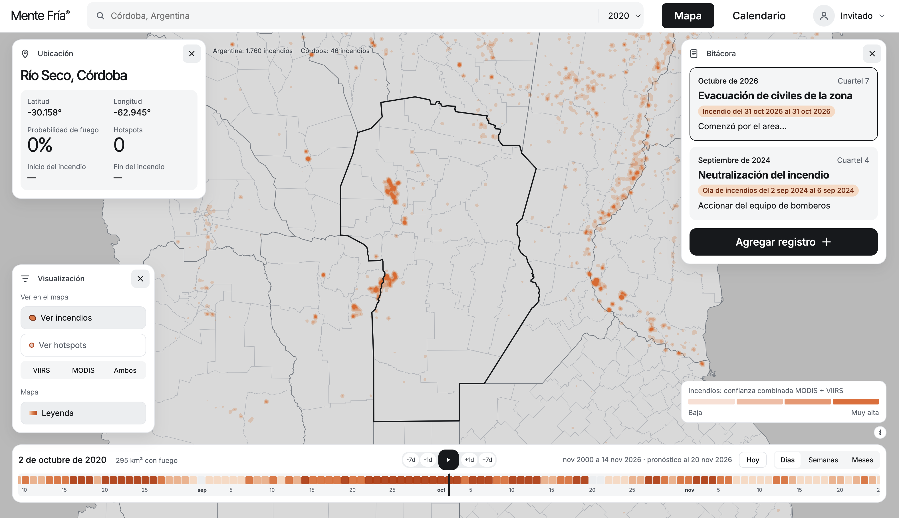
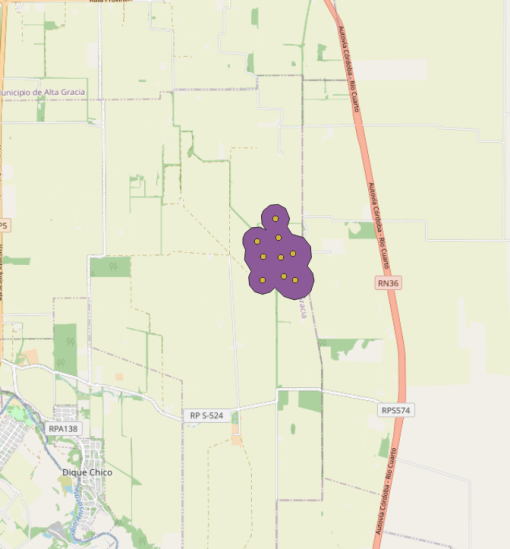
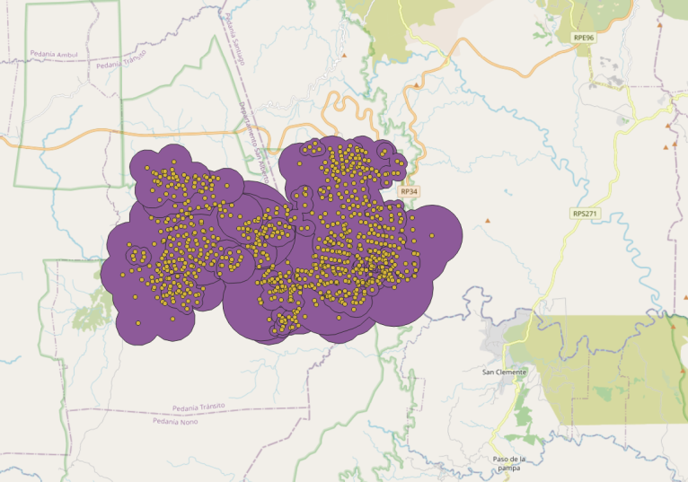
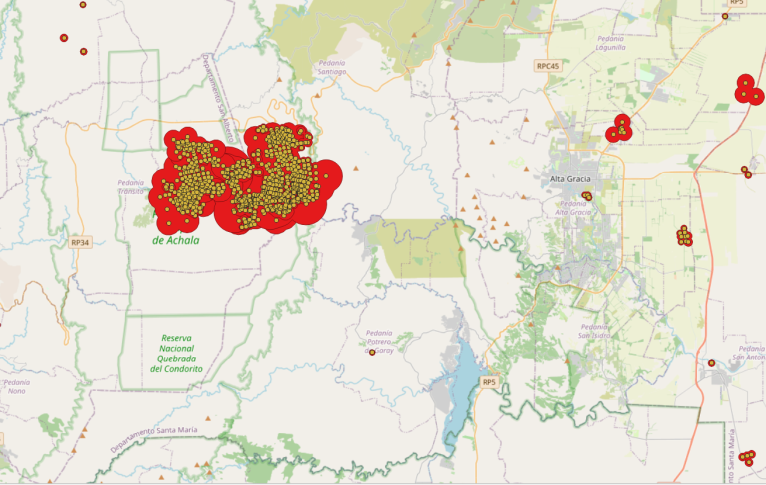
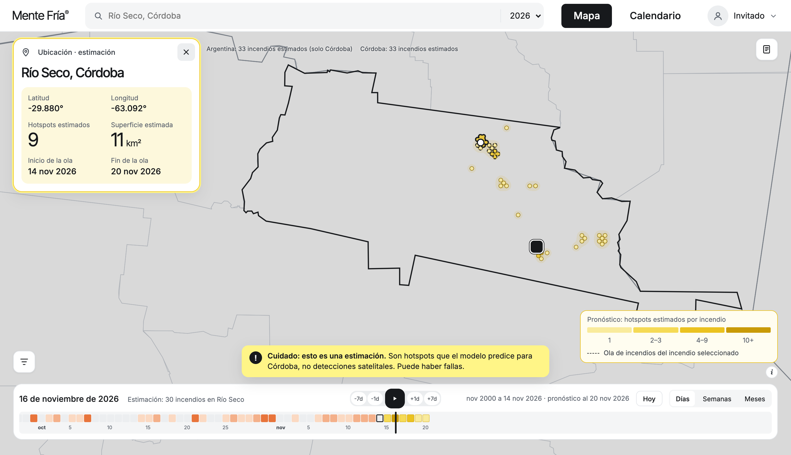

# nasa-space-app-modis

*[Read in English](README.en.md)*

> Herramienta web "mente fría" con un calendario armonizado de actividad de fuego a partir de los hotspots de MODIS y VIIRS de NASA FIRMS, junto con una prueba piloto de predicción de hotspots en Córdoba.



**NASA Space Apps Challenge** · Desafío: *Harmonization of MODIS and VIIRS Hot Spots*

**Equipo:** Firewall

| Integrante | Especialización|
|---|---|
| Ana Carolina Olivera | Doctora en Ciencias de la Computación\* |
| Francisco Devaux | Estudiante Licenciatura en Ciencias de la Computación\* |
| Aída Laricchia | Estudiante Licenciatura en Ciencias de la Computación\* |
| Ignacio Coppede Santos | Estudiante Licenciatura en Ciencias de la Computación\* |
| Franco Elian Gimenez | Estudiante Diseño Gráfico\*\* |
| Martina Nahman | Estudiante Licenciatura en Ciencias de la Computación\* |

\* Universidad Nacional de Cuyo  
\*\* Instituto Manuel Belgrano

---

## Resumen

Desarrollamos un método para armonizar los hotspots de MODIS y VIIRS de NASA FIRMS, aplicado a toda Argentina entre 2000 y 2026. En lugar de comparar puntos sueltos, agrupamos los hotspots en unidades con significado físico: los fires, que reúnen los píxeles que se tocan dentro de una ventana de 12 horas, junto con los firewaves, que encadenan fires a lo largo de los días. Cada unidad tiene su polígono además de una confianza que combina ambos sensores. De esta manera, el sensor de origen deja de importar, tal como pide el desafío. Como el método usa el tamaño real de cada píxel, se adapta a nuevos satélites cuando MODIS deje de operar. Sumamos una prueba piloto en Córdoba, provincia desde donde la CONAE presentó el desafío: un modelo CNN + LSTM que anticipa nuevos hotspots a siete días. Además, la aplicación web ofrece un espacio para que los brigadistas registren reportes en la bitácora de cada firewave, que a futuro podría guiar planes de acción. Este trabajo es importante porque los fuegos son cada vez más frecuentes e intensos, por lo que quienes gestionan emergencias necesitan una referencia histórica confiable.

## Problema

**Los regímenes de fuego están cambiando.** Algunos ecosistemas necesitan fuegos periódicos para mantener tanto su estructura como su funcionamiento. Sin embargo, los cambios en la intensidad, la extensión o la frecuencia de los fuegos afectan el clima, la sociedad, la biodiversidad e incluso los servicios ecosistémicos. Además, los fuegos provocan pérdidas humanas y materiales. También dañan la salud de la población, a la vez que ponen en riesgo a quienes los combaten [2].

**Los satélites permiten seguirlos.** Los modelos climáticos proyectan condiciones de fuego cada vez más frecuentes e intensas. Frente a este escenario, los satélites de observación de la Tierra miden la radiación térmica junto con el humo, desde escala regional hasta global. Gracias a ello, sirven para la detección temprana, la respuesta rápida o la evaluación posterior al fuego. En particular, los sensores que operan en el infrarrojo medio y térmico detectan **hotspots** (puntos de calor) generados por incendios, volcanes o procesos industriales. Dos de esos sensores son MODIS y VIIRS [2].

**Los calendarios de actividad de fuego** integran información histórica con datos recientes. De esta manera, permiten identificar rápidamente los patrones estacionales, las anomalías o las tendencias de cada región [2].

Los sensores MODIS, a bordo de los satélites Terra y Aqua, acumulan más de dos décadas de observaciones. No obstante, están llegando al final de su vida útil, por lo que están siendo reemplazados por VIIRS [7][8]. El inconveniente es que los registros de ambos **no se pueden comparar directamente sin armonizarlos** ya que difieren en resolución espacial, sensibilidad y horarios de observación [2].

Por eso, a medida que los fuegos se vuelven más frecuentes e intensos, quienes gestionan emergencias necesitan contar con un calendario de hotspots actualizado y consistente. Con esta herramienta podrían identificar los meses o los años de mayor actividad de fuego [2].

## Objetivos

### Objetivo general

Desarrollar una aplicación web con un calendario armonizado de actividad de fuego basado en hotspots satelitales que combine la extensa serie histórica de MODIS con la continuidad y el mayor detalle de VIIRS, a fin de obtener una serie temporal consistente [2].

### Objetivos específicos

1. Armonizar los hotspots de MODIS y VIIRS de NASA FIRMS, de modo que el sensor de origen deje de influir en el análisis.
2. Construir, a partir de los datos armonizados, una serie temporal consistente que permita identificar patrones, tendencias o anomalías en la actividad de fuego.
3. Desarrollar una aplicación web que a partir de los datos armonizados permita seleccionar una región junto con un rango de fechas.

## Nuestra solución

Nuestra propuesta aborda la armonización de los hotspots de MODIS y VIIRS enfocada en Argentina. Para ello trabajamos con todos los registros de NASA FIRMS disponibles para el país: MODIS desde noviembre de 2000 hasta noviembre de 2026, VIIRS desde enero de 2012 hasta la misma fecha [3].

Por otra parte, sumamos una etapa de predicción de nuevos hotspots con una prueba piloto en **Córdoba**. Elegimos esta provincia porque el desafío *Harmonization of MODIS and VIIRS Hot Spots* surgió de la CONAE, agencia espacial argentina socia de NASA Space Apps [12]. El video oficial del desafío lo presenta desde el Centro Espacial Teófilo Tabanera, en Córdoba [13]. El detalle se encuentra en la sección [Predicción de nuevos hotspots en Córdoba](#predicción-de-nuevos-hotspots-en-córdoba).

En lugar de comparar hotspots sueltos, los agrupamos en unidades que representan lo mismo sin importar qué satélite los detectó. De esta manera, el sensor de origen deja de ser relevante. La agrupación la organizamos en tres niveles:


- **Hotspot:** cada detección original de FIRMS. Conserva su formato sin modificaciones.
- **Fire:** cluster de hotspots cuyos píxeles se tocan dentro de una misma ventana de 12 horas. Un fire puede reunir detecciones de MODIS junto con detecciones de VIIRS.
- **Firewave:** conjunto de fires cercanos que se suceden en el tiempo. Por ejemplo, un frente de fuego que avanza durante varios días forma un único firewave.

Además, cada fire cuenta con el polígono que delimita su extensión, al igual que cada firewave. Ambos incluyen también una métrica de confianza propia que combina la información de los dos sensores.

A su vez, este enfoque es independiente del satélite que adquiere cada hotspot. Por lo tanto, la armonización puede incorporar nuevos satélites sin rediseñar el método (ver sección 7).

El procesamiento se divide en etapas encadenadas. Todos los umbrales, pesos y períodos se definen en un archivo de configuración, de modo que ningún valor queda fijo en el código.

### 1. Ingesta y limpieza

Se leen los CSV crudos de FIRMS: el archivo histórico, el producto estándar (SP) y los datos casi en tiempo real (NRT). Luego se eliminan las detecciones duplicadas. Cuando un mismo hotspot aparece en más de un producto, se prioriza el estándar por sobre el NRT.

Para quedarnos solo con fuegos de vegetación, conservamos los hotspots con `type = 0`. Así se descartan volcanes, fuentes estáticas (por ejemplo, fábricas) o detecciones en el mar [4][5].

Sin embargo, los datos NRT no traen el campo `type` [3]. Por eso lo inferimos a partir del histórico: un hotspot NRT se descarta si su píxel toca el de algún hotspot con `type ≠ 0` detectado durante los 365 días anteriores. El criterio se apoya en la definición de NASA, que considera fuente estática a un punto detectado 16 días o más en un mismo año [5]. Cuando NASA publique el producto estándar de esas fechas, el valor inferido se podría reemplazar por el oficial, ya que el campo `type` sí viene en el producto estándar [4].

Por último, no recortamos los datos a Argentina antes de agrupar. Primero se forman los fires con todos los puntos, luego se conservan los que tienen al menos un hotspot dentro del país. De esta manera, los fires de frontera no quedan partidos.

### 2. Clase de confianza común

Cada sensor informa la confianza de distinta manera: MODIS usa un número de 0 a 100, mientras que VIIRS usa las clases `l` (baja), `n` (nominal) o `h` (alta) [4]. Como VIIRS es la referencia a futuro, llevamos MODIS a las clases de VIIRS con los umbrales oficiales de NASA (Tabla 11 de [5]):

| Confianza MODIS | Clase |
|---|---|
| 0 ≤ C < 30 | `l` |
| 30 ≤ C < 80 | `n` |
| 80 ≤ C ≤ 100 | `h` |

Esta clase común se usa únicamente para calcular la confianza de los fires. En cambio, la confianza original de cada hotspot no se modifica.

### 3. De hotspots a fires: clustering espacial

**Ventana de 12 horas.** Primero dividimos las detecciones en ventanas diurnas o nocturnas de 12 horas, con cortes a las 07:00 y a las 19:00 (hora argentina). En esas franjas no pasa ningún satélite, por lo que ninguna pasada queda partida.

**Contacto de píxeles.** La coordenada de un hotspot corresponde al centro del píxel, pero el fuego puede estar en cualquier punto dentro de él [3]. A su vez, el tamaño del píxel varía: en MODIS va de 1 km en el nadir a casi 5 km en el borde de la pasada, mientras que en VIIRS mide 375 m [3][4]. Una distancia fija partiría fires o uniría fires distintos.

Por eso, dos hotspots pertenecen al mismo fire si sus píxeles se tocan, incluso por una esquina. Es el mismo criterio de contacto que usan otros productos de incendios citados en la Tabla 1 de [15]. Cada píxel se aproxima por el círculo que lo contiene, cuyo radio es la semidiagonal del píxel:

```
r_i = ½ · √(scan_i² + track_i²)
i ~ j  ⇔  d_ij ≤ r_i + r_j
```

Aquí `scan` × `track` es el tamaño real del píxel informado por FIRMS [4], mientras que `d_ij` es la distancia entre los centros. Como cada hotspot aporta su propio radio, el mismo criterio sirve para pares MODIS–MODIS, VIIRS–VIIRS o mixtos:

| Par de píxeles | Distancia máxima |
|---|---|
| MODIS + MODIS (nadir) | 1,41 km |
| VIIRS + VIIRS (nadir) | 0,53 km |
| MODIS + VIIRS (nadir) | 0,97 km |
| MODIS + MODIS (borde de la pasada) | 5,2 km |

Las distancias se calculan en metros sobre una única proyección Transversa de Mercator centrada en el meridiano −63°, el mismo de la faja 4 de POSGAR 2007 [16]. Así, un fire nunca queda repartido entre dos sistemas de coordenadas.

Finalmente, los fires se obtienen mediante un **clustering espacial** de los hotspots: un árbol k-d encuentra los pares cercanos, luego un algoritmo de componentes conexas los agrupa. El resultado equivale a un DBSCAN con `min_samples = 1` en el que la distancia entre dos hotspots se divide por la suma de sus radios (`d_ij / (r_i + r_j)`, con `eps = 1`) [19]. Lo verificamos sobre los hotspots de 2025: ambos métodos dan la misma partición en las 729 ventanas. Los hotspots aislados forman fires de un solo punto, que también se conservan.



*Figura 1. Fire generado por el clustering cerca de Dique Chico y Alta Gracia (Córdoba, 2025), visto en QGIS. Los puntos amarillos son hotspots, mientras que la zona violeta es el fire que forman sus píxeles al tocarse.*

### 4. De fires a firewaves

Un fuego que continúa al día siguiente aparece como un fire nuevo en otra ventana de 12 horas. Para reconstruir el fuego completo, recorremos las ventanas en orden temporal siguiendo el algoritmo de NASA FEDS [6][15]:

- Un fire se suma a un firewave activo si alguno de sus hotspots está a una distancia de hasta `r_i + r_j + buffer` de un hotspot del firewave detectado en los últimos 5 días.
- El buffer es de **5 km** cuando el firewave está en un área protegida con bosque. En cualquier otro caso es de **1 km**.
- Si un fire toca dos firewaves o más, estos se fusionan en uno solo.
- Un firewave se cierra cuando pasan 5 días sin fires nuevos.

El buffer evita que un frente de fuego se divida en varios firewaves cuando avanza entre pasadas [18] o cuando queda oculto por nubes o humo [3]. Los valores de 1 y 5 km, junto con los 5 días, provienen de FEDS, que trabaja con el mismo tipo de dato (VIIRS de 375 m) [15]. En nuestro caso, el buffer de 5 km se aplica solo a bosques dentro de áreas protegidas.

### 5. Métrica de confianza

Agregamos una métrica nueva, `confidence` (de 0 a 100 %), para cada fire y cada firewave. Sus componentes, en orden de importancia, son:

1. **Corroboración independiente.** La confianza sube cuando otro sensor u otra pasada detecta el mismo fuego. Algunas falsas detecciones dependen de las condiciones de cada pasada, como el reflejo solar [5], de modo que los hotspots de una misma pasada no son evidencia independiente. Por lo tanto, se cuentan pasadas en lugar de puntos.
2. **Clase NASA de los hotspots.** Cada clase aporta un puntaje (`h` = 0,90, `n` = 0,55, `l` = 0,15), que corresponde al punto medio de los rangos de la Tabla 11 de [5]. A su vez, los hotspots MODIS se multiplican por 0,80 debido a su menor precisión.
3. **Ausencia de VIIRS.** VIIRS detecta mejor los fuegos chicos [3]. Por eso, si MODIS detectó un fuego que VIIRS no vio estando operativo, la confianza baja. Los períodos operativos de cada satélite surgen de [7][8][9]. Antes de 2012 esta penalización no se aplica, ya que VIIRS todavía no existía.
4. **Tamaño.** El área total de los píxeles suma un aporte leve. Se usa el área en lugar de la cantidad de hotspots, ya que un píxel MODIS (1 km) ocupa el área de unos 7 píxeles VIIRS (375 m) [3].

```
p_i  = p(clase_i) · w_sensor_i
P    = 1 − (1 − p_MODIS) · (1 − p_VIIRS)          ← combina ambos sensores (noisy-OR)
P    ← 1 − (1 − P) · (1 − 0,20)^(k − 1)           ← k = cantidad de pasadas distintas
confidence = 100 · P · f_tamaño · f_ausencia_VIIRS
```

Por ejemplo, un fire con un hotspot MODIS de clase `n` junto con uno VIIRS de la misma clase obtiene un 75 %.

Para que la métrica sea **comparable entre épocas**, la corroboración se limita a una observación por familia de sensor. De lo contrario, los años recientes, con cinco satélites, tendrían siempre más confianza que los primeros, con uno solo. Por su parte, el firewave toma el promedio de la confianza de sus fires, ponderado por el área.

### 6. Polígonos y contexto


- **Polígono del fire:** unión de los círculos de sus hotspots. Como los círculos de un mismo fire se tocan, el resultado es siempre un único polígono.
- **Polígono del firewave:** unión de los polígonos de sus fires. Puede tener varias partes, ya que los fires se enlazan con buffer.
- **Área protegida:** un fire está en un área protegida si al menos uno de sus hotspots cae dentro de alguna de las 506 áreas de la capa del IGN [17].
- **Bosque:** un fire es de bosque si la cobertura mayoritaria bajo su polígono es bosque, según el producto NASA MCD12Q1 del año correspondiente [10]. El criterio de cobertura mayoritaria es el mismo que usa FEDS [15].



*Figura 2. Polígonos de fires en las Sierras Grandes de Córdoba (2025), vistos en QGIS. Cada polígono violeta es la unión de los círculos de sus hotspots (puntos amarillos). Los círculos más grandes corresponden a píxeles MODIS, que pueden abarcar círculos VIIRS más chicos, ya que un mismo fire puede reunir detecciones de ambos sensores. Los polígonos superpuestos son fires de distintas ventanas de 12 horas, ya que dentro de una misma ventana dos círculos que se tocan pertenecen siempre al mismo fire.*

### 7. Continuidad sin MODIS y adaptabilidad a nuevos satélites

Cada fire lleva una columna `era` (solo MODIS, MODIS + VIIRS o solo VIIRS). La métrica funciona sin MODIS: un fire detectado solo por VIIRS con clase `h` obtiene un 90 %, mientras que uno detectado solo por MODIS antes de 2012 tiene un techo de 72 %. Gracias a esto, el pipeline seguirá siendo útil cuando Terra y Aqua dejen de operar [7].

El método no depende de un sensor en particular. El criterio de contacto usa el tamaño real de cada píxel, mientras que la clase de confianza común permite traducir cualquier escala a `l`/`n`/`h`. A su vez, la confianza cuenta una observación por familia de sensor, por lo que sumar satélites no altera la comparabilidad de la serie.

Las fuentes de datos, los satélites y sus períodos operativos se definen en el archivo de configuración. Así, sumar o retirar un satélite no requiere modificar el código. Este mecanismo ya se usó para incorporar NOAA-21 [9], registrar el standby de Terra [8] o el fin de S-NPP [9]. Un futuro satélite con VIIRS, como JPSS-3 o JPSS-4 [14], se incorporaría de la misma forma. En cambio, una familia de sensores nueva requiere además definir su peso, junto con una extensión del cálculo de confianza.

### Salidas

| Archivo | Contenido |
|---|---|
| `hotspots.parquet` | hotspots en el formato original de FIRMS, con el identificador de su fire junto con el de su firewave |
| `incendios.parquet` | atributos de cada fire, incluido su polígono |
| `eventos.parquet` | atributos de cada firewave, incluido su polígono |
| `fuego.gpkg` | GeoPackage con capas de hotspots, fires, firewaves, áreas protegidas y límites provinciales, listo para abrir en QGIS |

Todos los datos del proyecto, incluidas estas salidas, están disponibles en [1]. Las coordenadas se exportan en WGS84 (longitud/latitud), el mismo sistema que usa FIRMS [3]. El detalle de cada decisión está en [PLAN.md](PLAN.md).

Para comprobar la clusterización, cargamos las salidas en QGIS sobre un mapa de referencia:



*Figura 3. Vista regional de Córdoba (2025) en QGIS. Los puntos amarillos son hotspots, mientras que las zonas rojas son fires. Se observa un fire extenso en las Sierras Grandes, junto a la Reserva Nacional Quebrada del Condorito, además de fires pequeños en los alrededores de Alta Gracia.*

## Predicción de nuevos hotspots en Córdoba

**Por qué Córdoba.** El desafío *Harmonization of MODIS and VIIRS Hot Spots* surgió de la CONAE. En el video oficial de presentación, Marina Compagnucci, de la CONAE, introduce el problema desde el Centro Espacial Teófilo Tabanera, en Córdoba [13]. Por eso, la prueba piloto de predicción se realizó sobre esta provincia, mientras que la armonización abarca todo el país.

**Objetivo.** El calendario armonizado describe la actividad de fuego que ya ocurrió. En cambio, la etapa de predicción busca anticipar dónde pueden aparecer nuevos hotspots en los siete días siguientes a una detección. El modelo no predice fires ni firewaves de forma directa: predice hotspots que luego agrupa con la misma lógica de las secciones 3 y 4. De esta manera, se mantienen las mismas definiciones de fire y firewave en todo el proyecto, sin crear una entidad nueva.

### Alcance y datos

La prueba piloto se realizó sobre una grilla de celdas de 1 km en una proyección de áreas iguales (EPSG:6933). Cada muestra se ancla en un hotspot observado [3][4] a partir del cual se construye un parche de 32 × 32 celdas (32 × 32 km) con 14 días de historia, además de un horizonte de 7 días. Para no repetir parches casi idénticos, se usa una muestra por celda-día con al menos un hotspot. La celda-día es solo el punto de lectura, no una entidad nueva: el modelo sigue trabajando con hotspots.

Los períodos se separaron temporalmente para que ni la validación ni el test compartan información con el entrenamiento:

| Período | Fechas | Hotspots | Muestras (celda-día) |
|---|---|---:|---:|
| Entrenamiento | 2019-01-01 → 2025-07-24 | 91.074 | 32.661 |
| Validación | 2025-08-01 → 2026-07-24 | 6.133 | 2.913 |
| Test | 2026-08-01 → 2026-11-07 | 2.223 | 1.145 |

Se eligió el período 2019-2025 porque concentra el régimen reciente de sensores y de combustible. En el conjunto resultante, el 0,45 % de las celdas-día son positivas, mientras que el 72,3 % de las anclas tiene al menos un hotspot futuro dentro del parche. Además, se aplicó una purga de siete días en los bordes entre períodos para que ninguna etiqueta cruce el límite.

### Representación

Cada muestra combina 20 canales dinámicos de historia, 7 canales de clima futuro, 12 canales estáticos junto con un vector de 17 atributos del hotspot ancla:

- **Historia:** resume el campo de hotspots (conteo, presencia, densidad gaussiana, FRP, confianza, sensor, día/noche) junto con la meteorología observada. La meteorología proviene de NASA POWER [11][20], a la que se suman derivados como el VPD, los días sin lluvia o la precipitación acumulada a 7 y 30 días.
- **Clima futuro:** contiene siete días de meteorología. Durante el entrenamiento, la validación y el test se usaron los valores observados de NASA POWER como reemplazo del pronóstico [11][20], ya que no existe un archivo histórico de pronósticos. En cambio, la predicción operativa usa el pronóstico extendido a 7 días de Open-Meteo [21], porque NASA POWER no ofrece pronósticos.
- **Estáticos:** incluyen la máscara de Córdoba, el departamento, la cobertura de suelo del año anterior, las áreas protegidas [17], la climatología de fuego, la distancia al centro del parche, la distancia al hotspot conocido más cercano y los días desde el último hotspot. La cobertura de suelo se toma del año anterior para no incorporar cicatrices del mismo año del fuego [22].
- **Ancla:** incluye FRP, confianza, sensor, satélite, tamaño de píxel, día/noche, hora, estación junto con el ONI del trimestre anterior [28].

### Modelo y entrenamiento

La red tiene tres partes [23][24]:

1. Una CNN compartida codifica cada día de historia.
2. Una LSTM resume la secuencia de 14 días.
3. Un decoder convolucional, condicionado por el vector del ancla junto con el clima futuro de cada día, produce siete mapas de 32 × 32 con la probabilidad de hotspot.

El modelo tiene alrededor de 2,5 millones de parámetros. Se entrenó en una GPU RTX 4060 de 8 GB.

Como los hotspots son muy raros frente al total de celdas, la pérdida combina una BCE ponderada con `pos_weight = 75` junto con una penalización por parche [25]:

```
L = BCE_pos + λ · L_patch
L_patch = −log(max p(celda) sobre las celdas con hotspot real)
```

El segundo término obliga a que cada parche-día con hotspots futuros tenga al menos una celda con probabilidad alta. Así, se penalizan con fuerza los falsos negativos sin crear una entidad de fire. Durante el entrenamiento se aplicaron rotaciones, espejados y traslaciones de hasta cuatro celdas. Además, se usó AdamW con learning rate 2 × 10⁻⁴, weight decay 10⁻³ junto con early stopping sobre la validación.

### Evaluación de hotspots

La evaluación principal no depende de un umbral: usa PR-AUC, ROC-AUC y Brier [29], acompañados de recall, precisión y F1 a distintos cortes [26]. También se mide el *patch hit rate*, es decir, la fracción de parches-día con hotspot futuro en los que al menos una celda positiva supera 0,5. El modelo se comparó contra dos baselines:

- **Persistencia:** repite los hotspots del día del ancla.
- **Climatología:** frecuencia histórica por celda y mes, calculada solo con el período de entrenamiento.

| Métrica | Validación | Test | Persistencia (val) | Climatología (val) |
|---|---:|---:|---:|---:|
| PR-AUC | **0,0122** | **0,0090** | 0,0068 | 0,0041 |
| ROC-AUC | 0,856 | 0,837 | 0,570 | 0,607 |
| Brier | 0,102 | 0,127 | 0,009 | 0,002 |
| Recall@0,2 | 0,896 | 0,900 | 0,147 | 0,000 |
| Recall@0,5 | 0,645 | 0,671 | 0,147 | 0,000 |
| Recall@0,7 | 0,432 | 0,439 | 0,147 | 0,000 |
| Patch hit | 0,769 | 0,792 | — | — |

El modelo supera a ambos baselines en PR-AUC y ROC-AUC. Además, mantiene un recall alto cuando se baja el umbral, que es el comportamiento buscado para alerta temprana. Sin embargo, el Brier es mayor que el de los baselines porque el modelo entrega probabilidades más extremas. Por eso, la calibración se reporta por separado [26][27].

### De hotspots predichos a fires y firewaves

Los hotspots con probabilidad superior a un umbral se deduplican por celda-día. Luego pasan por la misma lógica de las secciones 3 y 4 [15]:

- **Fires:** clustering por contacto de píxeles en ventanas de 12 horas.
- **Firewaves:** enlace con buffer de 1 km (5 km en área protegida con bosque), ventana de 5 días e inactividad de 5 días.

De esta manera, los fires no se predicen directamente: se derivan de los hotspots con el mismo criterio que el resto del pipeline.

La comparación con los fires y firewaves reales usa una tolerancia estricta: centroides a 1 km para fires, 2 km para firewaves, fechas dentro de ±1 día. Con el punto de operación 0,8 / 200 hotspots por día se obtuvo:

| | Validación | Test |
|---|---:|---:|
| Fires predichos | 12.619 | 3.245 |
| Firewaves predichos | 1.015 | 221 |
| Fires: precision / recall / F1 | 0,060 / 0,159 / 0,088 | 0,067 / 0,125 / 0,087 |
| Firewaves: precision / recall / F1 | 0,442 / 0,134 / 0,206 | 0,471 / 0,083 / 0,140 |

El barrido de umbral y presupuesto muestra el compromiso entre recall y precisión:

- **Mayor F1 de firewaves:** 0,8 / 1000 (F1 0,219).
- **Mejor equilibrio entre precisión y recall:** 0,9 / 500 (precisión 0,444, recall 0,139, F1 0,212).
- **Mayor precisión:** 0,9 / 50 (precisión 0,594, recall 0,099).

La coincidencia estricta de centroides y fechas explica en parte el recall bajo a nivel de firewave. En cambio, el recall de hotspots es mucho mayor.

### Predicción operativa

La última predicción se generó con los datos disponibles hasta el 13 de noviembre de 2026. Para el período del 14 al 20 de noviembre de 2026 se obtuvieron 15 celdas-día ancla, 271 hotspots, 131 fires y 20 firewaves. De esos 271 hotspots, 55 repiten una celda en el mismo día, por lo que quedan 216 celdas únicas. La historia meteorológica se tomó de POWER [11], mientras que los siete días futuros provienen del pronóstico extendido de Open-Meteo [21]. Si falta una variable o un día, se rellena con la última observación disponible, lo cual queda registrado. El resultado se guarda en `pred/predictions/latest_2026-11-13/` en formato GeoJSON y Parquet, listo para mapa o análisis.

### Limitaciones

- El clima de entrenamiento es observado, no pronosticado. Usar POWER como proxy del pronóstico hace que las métricas de validación sean optimistas frente a una operación real.
- La validación y el test incluyen cambios de sensores (la llegada de NOAA-21 junto con el standby de Terra) que no están representados por igual en el entrenamiento [8].
- El test de 2026 es corto. A su vez, la coincidencia de fires y firewaves es estricta.
- El modelo es experimental: complementa el calendario armonizado, no lo reemplaza.

## Aplicación web

Desarrollamos **mente fría**, una aplicación web que lleva los datos armonizados [1] a un mapa interactivo y a un calendario de actividad de fuego. La pensamos para brigadistas, equipos de alerta temprana, gestores del territorio y la comunidad científica [2]. De esta manera, cualquiera puede consultar dónde y cuándo hubo fuego sin preocuparse por el sensor que lo detectó.


*Figura 4. Vista Mapa de mente fría sobre Córdoba (2 de octubre de 2020). A la izquierda están la tarjeta del punto elegido junto con el menú de visualización. A la derecha se ve la bitácora con dos reportes de brigadistas. Abajo, la línea de tiempo muestra la actividad diaria de fuego.*

### Región, período y calendario

Con estas funciones respondemos al objetivo específico 3:

- **Región.** Un buscador permite elegir el país, una de las 24 provincias o uno de los 529 departamentos, según los límites del IGN [31].
- **Período.** La línea de tiempo abarca desde noviembre de 2000 hasta noviembre de 2026 [3]. Se recorre por días, semanas o meses. Además, puede reproducirse como animación o volver al último dato con un botón.
- **Fires y hotspots.** De lejos, el mapa muestra una mancha de calor. Al acercarse, aparecen los polígonos de los fires coloreados según su confianza. A su vez, al tocar un fire que integra un firewave, todos los fires de ese firewave se marcan con línea punteada. También se pueden ver los hotspots de MODIS, de VIIRS o de ambos.
- **Calendario armonizado.** La vista Calendario muestra ocho temporadas semana por semana junto con un calendario por semana, mes o temporada. Cada día indica la superficie con fuego y la cantidad de fires. Para comparar épocas, la superficie se expresa en la escala de VIIRS: antes de 2012 usamos el área de MODIS multiplicada por un factor calculado en el período de solapamiento.
- **Mapa y calendario conectados.** El punto elegido en el mapa pasa al calendario. Por otra parte, el calendario permite elegir provincia y departamento para listar los firewaves del mes con su inicio, su fin y su ubicación.

### Bitácora de brigadistas

- Cada reporte queda anclado a un punto del mapa con su fecha, su título y lo que pasó en el terreno. También admite una lección para la próxima vez.
- Cuando el punto pertenece a un firewave, el reporte queda vinculado a ese firewave. De esta manera, la bitácora une el dato satelital con la experiencia de campo.
- En el calendario, el botón **Reportar** abre el formulario con el lugar, la fecha y el firewave ya cargados.
- La bitácora muestra los reportes de la región elegida, del más reciente al más antiguo.
- Por ahora es un prototipo: no tiene cuentas de usuario y guarda los reportes en un archivo del servidor.

### Predicción en Córdoba

La aplicación también muestra la predicción operativa descripta en la sección anterior:

- La línea de tiempo continúa con los días pronosticados, del 15 al 20 de noviembre de 2026. El 14 de noviembre ya cuenta con datos observados, por lo que se muestran esos.
- El mapa muestra los hotspots predichos, los fires que forman con su polígono y los firewaves a los que pertenecen. El calendario, a su vez, indica cuántos fires se esperan cada día.
- Todo lo estimado usa una escala amarilla. En cambio, lo observado usa una escala naranja. Además, un aviso recuerda que se trata de una estimación.
- No mostramos el puntaje del modelo. Como solo se exportan las celdas que superan 0,8, ese valor siempre queda entre 80 % y 100 %. Por lo tanto, parecería más seguro que la confianza histórica, cuya mediana en Córdoba es de 48 %. En su lugar, el color indica la cantidad de hotspots de cada fire.
- La salida del modelo repite algunas celdas en un mismo día. Por eso, la aplicación cuenta cada celda una sola vez, lo que deja 216 hotspots en lugar de 271.
- Los polígonos de los fires predichos se reconstruyen con el mismo criterio de contacto de píxeles que usa la etapa de predicción.



*Figura 5. Predicción del 16 de noviembre de 2026 en el departamento Río Seco (Córdoba). Los círculos amarillos son hotspots predichos agrupados en fires. La tarjeta muestra el fire elegido junto con su firewave, mientras que el aviso indica que se trata de una estimación.*

### Disponibilidad

La aplicación todavía no está desplegada, por lo que no hay un enlace público. Por ahora se ejecuta de forma local. El código y las instrucciones para correrla están en la carpeta `webtool/`.

## Beneficios e impacto

### Beneficios

- **Un espacio para los brigadistas.** La aplicación web permite que los brigadistas generen reportes sobre un firewave en particular. Esos reportes forman la bitácora del firewave, que suma a los datos satelitales la experiencia de quienes estuvieron en el terreno. A futuro, estas bitácoras podrían usarse para generar planes de acción a partir de lo que los brigadistas hicieron en situaciones anteriores.
- **Una serie comparable a lo largo de los años.** La armonización permite comparar la actividad de fuego de distintas épocas sin que el cambio de sensores o la cantidad de satélites distorsionen el resultado.
- **Unidades con significado físico.** Los fires y firewaves representan fuegos en lugar de píxeles aislados. Cada uno incluye su polígono, su duración junto con su confianza, listos para verificar en QGIS.
- **Una confianza transparente.** La métrica combina ambos sensores con reglas explícitas. A su vez, sus pesos se pueden ajustar desde el archivo de configuración.
- **Preparado para el futuro.** El método funciona sin MODIS. Además, incorpora nuevos satélites con VIIRS solo mediante configuración [7][14].
- **Contexto ambiental.** Cada fire indica si ocurrió en un área protegida [17] o en bosque [10], lo cual permite priorizar zonas sensibles.
- **Anticipación.** La prueba piloto en Córdoba estima dónde pueden aparecer nuevos hotspots en los siete días siguientes, con un recall alto, que es lo que se busca en alerta temprana.
- **Formatos abiertos.** Las salidas se entregan en Parquet o GeoPackage, compatibles con herramientas libres de análisis geoespacial.

### Impacto esperado

El proyecto busca que los equipos de alerta temprana, los brigadistas, los gestores del territorio o la comunidad científica [2] cuenten con una referencia histórica consistente de la actividad de fuego. Con ella podrían identificar los meses o los años críticos, reconocer anomalías respecto del comportamiento habitual de cada región, además de priorizar el monitoreo de áreas sensibles.

Además, las bitácoras de los brigadistas convierten cada intervención en conocimiento acumulado. Con el tiempo, ese registro podría servir de base para planes de acción ante fuegos similares, de modo que la experiencia de campo no se pierda entre una temporada y otra.

En Córdoba, la prueba piloto muestra cómo esa misma base de datos puede pasar de describir el pasado a anticipar los próximos días. Por su parte, como el método no depende de un satélite en particular, la serie podrá mantenerse actualizada cuando MODIS deje de operar [7].

### Lo que hace original a nuestra propuesta

- **Datos satelitales junto con la experiencia de campo.** Cada firewave puede tener una bitácora con los reportes de los brigadistas, que a futuro podría alimentar planes de acción.
- **Comparar fuegos en lugar de puntos.** La unidad de análisis deja de ser el hotspot de cada sensor para pasar a ser el fire o el firewave.
- **Un criterio de contacto basado en el tamaño real de cada píxel.** Une detecciones de MODIS con detecciones de VIIRS sin umbrales especiales para cada par de sensores.
- **Una confianza comparable entre épocas.** La métrica no premia la mayor cantidad de satélites de los años recientes.
- **Una predicción coherente con la armonización.** El modelo predice hotspots, luego los agrupa con las mismas definiciones de fire y firewave, sin crear entidades nuevas.

### Factores considerados

- **Diferencias entre sensores.** MODIS y VIIRS difieren en resolución, escala de confianza y horarios de observación. Por eso usamos el tamaño real de cada píxel junto con una clase de confianza común (secciones 2 y 3).
- **Comparabilidad entre épocas.** La cantidad de satélites pasó de uno a cinco. Para no distorsionar la serie, la confianza cuenta una observación por familia de sensor (sección 5).
- **Fin de MODIS y nuevos satélites.** Tuvimos en cuenta el standby de Terra, el fin de S-NPP y la llegada de futuros satélites con VIIRS (sección 7).
- **Datos casi en tiempo real incompletos.** Los datos NRT no traen el campo `type`, por lo que lo inferimos a partir del histórico (sección 1).
- **Fuegos de frontera.** Agrupamos los hotspots antes de recortar a Argentina, de modo que ningún fire queda partido en el límite del país (sección 1).
- **Contexto ambiental.** Las áreas protegidas con bosque usan un buffer mayor para enlazar fires en firewaves (secciones 4 y 6).
- **Licencias de datos.** Descartamos la base mundial de áreas protegidas WDPA, ya que sus términos prohíben redistribuir los datos [30]. En su lugar usamos la capa oficial del IGN [17].
- **Validación.** Comprobamos que el clustering equivale a un DBSCAN sobre los hotspots de 2025. Además, verificamos visualmente los fires en QGIS (sección 3 y Salidas).
- **Fuga de información en la predicción.** Los períodos de entrenamiento, validación y test se separaron en el tiempo con una purga de siete días. A su vez, la cobertura de suelo es la del año anterior, mientras que el ONI es el del trimestre anterior (Predicción de nuevos hotspots en Córdoba).

## Herramientas utilizadas

*(A completar)*

## Fuentes

### Datos del proyecto

- **[1]** Equipo Firewall (2026), *Datos del proyecto: hotspots, fires, firewaves y salidas de la predicción* [carpeta de Google Drive]. https://drive.google.com/drive/folders/1NxEGVQ_2R2jd3KRyfYBsDF-JKva3DaI6?usp=sharing

### Fuentes de NASA

- **[2]** NASA Space Apps Challenge 2026, *Harmonization of MODIS and VIIRS Hot Spots*. https://www.spaceappschallenge.org/2026/challenges/modis-and-viirs-hot-spots/?tab=details
- **[3]** NASA Earthdata, *FIRMS Frequently Asked Questions*. https://www.earthdata.nasa.gov/data/tools/firms/faq
- **[4]** NASA Earthdata, *FIRMS Active Fire Data Attributes (MODIS/VIIRS)*. https://www.earthdata.nasa.gov/data/tools/firms/active-fire-data-attributes-modis-viirs
- **[5]** Giglio, L. et al. (2021), *MODIS Collection 6/6.1 Active Fire Product User's Guide v1.0*. NASA. https://earthdata.nasa.gov/s3fs-public/2023-09/MODIS_C6_C6.1_Fire_User_Guide_1.0.pdf
- **[6]** NASA Earth Information System, *Fire Event Data Suite (FEDS): documentación del Fire Atlas*. https://earth-information-system.github.io/fireatlas/docs/data_overview.html
- **[7]** NASA LAADS DAAC, *MODIS to VIIRS Transition*. https://ladsweb.modaps.eosdis.nasa.gov/learn/modis-to-viirs-transition/
- **[8]** NASA Earthdata, *Terra MODIS placed in standby mode*. https://www.earthdata.nasa.gov/data/alerts-outages/terra-modis-placed-standby-mode
- **[9]** NASA Earthdata, *Transitioning from Suomi NPP VIIRS/OMPS: what FIRMS users need to know*. https://www.earthdata.nasa.gov/news/blog/transitioning-from-suomi-npp-viirs-omps-what-firms-users-need-know
- **[10]** NASA LP DAAC, *MCD12Q1 v061: MODIS/Terra+Aqua Land Cover Type Yearly L3 Global 500 m*. https://www.earthdata.nasa.gov/data/catalog/lpcloud-mcd12q1-061
- **[11]** NASA POWER Project, *Prediction Of Worldwide Energy Resources*. https://power.larc.nasa.gov/
- **[12]** NASA Space Apps Challenge 2026, *Space Agency Partners*: Argentina, Comisión Nacional de Actividades Espaciales (CONAE). https://www.spaceappschallenge.org/2026/space-agency-partners/
- **[13]** NASA Space Apps Challenge (2026), *2026 Challenge | Harmonization of MODIS and VIIRS Hot Spots* [video]. YouTube, canal oficial de NASA Space Apps Challenge, embebido en la página del desafío. https://www.youtube.com/watch?v=tEPHsiZtuvk
- **[14]** NASA Goddard Space Flight Center, *Visible Infrared Imaging Radiometer Suite (VIIRS)*. https://science.gsfc.nasa.gov/sci/projects/558/

### Otras fuentes

- **[15]** Chen, Y. et al. (2022), *California wildfire spread derived using VIIRS satellite observations and an object-based tracking system*. Scientific Data 9:249. Artículo científico que describe la metodología de FEDS. https://doi.org/10.1038/s41597-022-01343-0
- **[16]** EPSG, *POSGAR 2007 / Argentina 4* (EPSG:5346), meridiano central −63°. https://epsg.io/5346
- **[17]** Instituto Geográfico Nacional (IGN) de Argentina, servicio WFS, capa `ign:area_protegida` (fuente SIB/IGN). https://wms.ign.gob.ar/geoserver/ows?service=wfs&version=2.0.0&request=DescribeFeatureType&typeNames=ign:area_protegida
- **[18]** Andela, N. et al. (2019), *The Global Fire Atlas of individual fire size, duration, speed and direction*. Earth System Science Data 11:529–552. https://essd.copernicus.org/articles/11/529/2019/
- **[19]** scikit-learn, *sklearn.cluster.DBSCAN*: documentación de los parámetros `eps`, `min_samples` y `metric`. https://scikit-learn.org/stable/modules/generated/sklearn.cluster.DBSCAN.html
- **[20]** Gelaro, R. et al. (2017), *The Modern-Era Retrospective Analysis for Research and Applications, Version 2 (MERRA-2)*. Journal of Climate 30(14):5419–5454. Reanálisis en el que se basa NASA POWER. https://doi.org/10.1175/JCLI-D-16-0758.1
- **[21]** Zippenfenig, P. (2024), *Open-Meteo.com Weather API*. Zenodo. https://doi.org/10.5281/zenodo.7970649
- **[22]** Sulla-Menashe, D. et al. (2019), *Hierarchical mapping of annual global land cover 2001 to present: The MODIS Collection 6 Land Cover product*. Remote Sensing of Environment 222:183–194. https://doi.org/10.1016/j.rse.2018.12.013
- **[23]** LeCun, Y. et al. (1998), *Gradient-based learning applied to document recognition*. Proceedings of the IEEE 86(11):2278–2324. https://doi.org/10.1109/5.726791
- **[24]** Hochreiter, S. y Schmidhuber, J. (1997), *Long Short-Term Memory*. Neural Computation 9(8):1735–1780. https://doi.org/10.1162/neco.1997.9.8.1735
- **[25]** Lin, T.-Y. et al. (2017), *Focal Loss for Dense Object Detection*. ICCV 2017. https://doi.org/10.1109/ICCV.2017.324
- **[26]** Saito, T. y Rehmsmeier, M. (2015), *The Precision-Recall Plot Is More Informative than the ROC Plot When Evaluating Binary Classifiers on Imbalanced Datasets*. PLoS ONE 10(3):e0118432. https://doi.org/10.1371/journal.pone.0118432
- **[27]** Guo, C. et al. (2017), *On Calibration of Modern Neural Networks*. ICML 2017. https://arxiv.org/abs/1706.04599
- **[28]** NOAA Climate Prediction Center, *Oceanic Niño Index (ONI)*. https://www.cpc.ncep.noaa.gov/data/indices/oni.ascii.txt
- **[29]** Brier, G. W. (1950), *Verification of forecasts expressed in terms of probability*. Monthly Weather Review 78(1):1–3. https://doi.org/10.1175/1520-0493(1950)078%3C0001:VOFEIT%3E2.0.CO%3B2
- **[30]** UNEP-WCMC, Protected Planet, *Legal*: términos de uso de la base mundial de áreas protegidas (antes WDPA, hoy WDPCA). https://www.protectedplanet.net/en/legal
- **[31]** Instituto Geográfico Nacional (IGN) de Argentina, servicio WFS, capas `ign:provincia` y `ign:departamento`. https://wms.ign.gob.ar/geoserver/ows?service=wfs&version=2.0.0&request=GetCapabilities